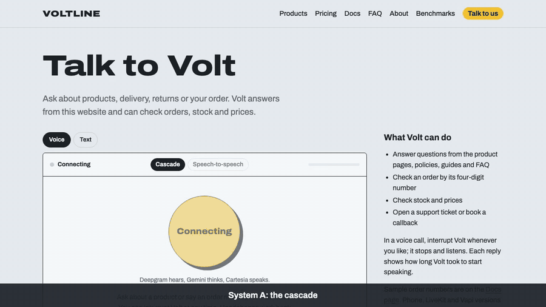
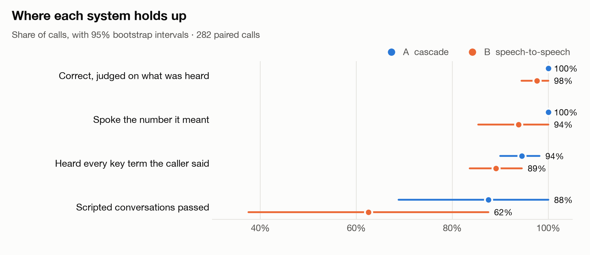
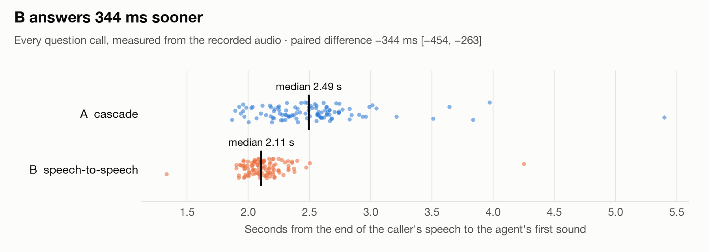
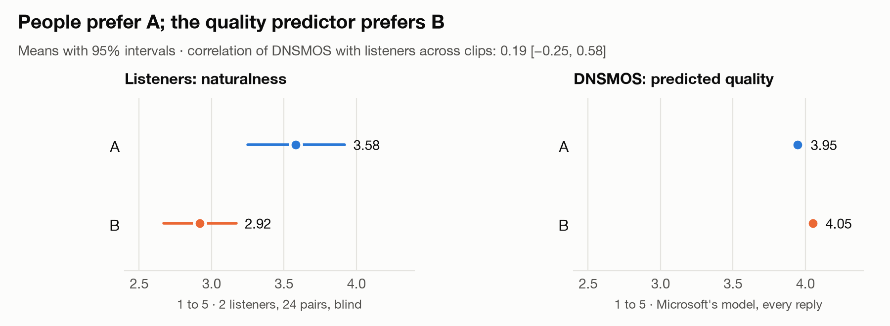
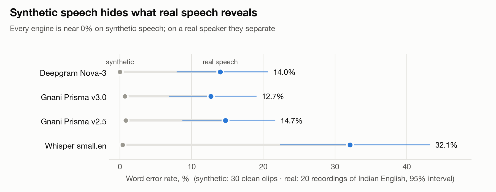
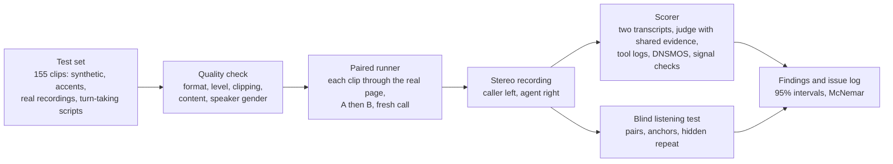
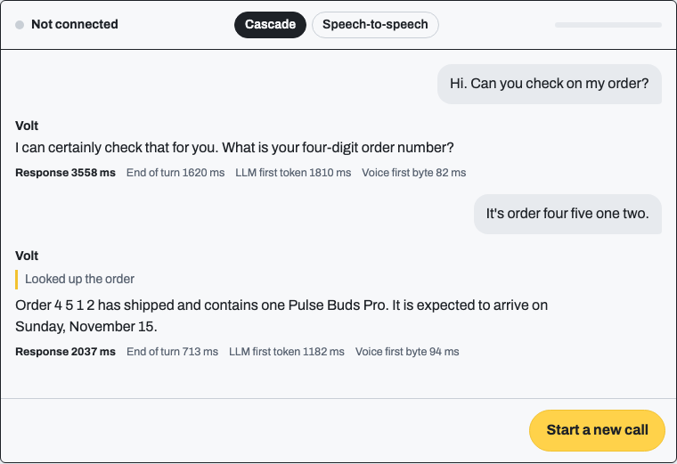
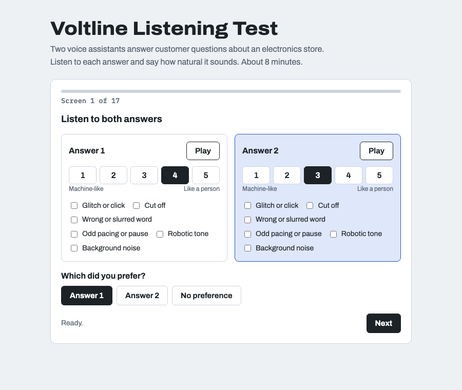

# Voltline voice agents: cascade against speech-to-speech

<p align="center">
  
</p>

Two voice agents answer the same customer calls for a fictional electronics store, with the same prompt, knowledge base and tools. This repository builds both, and then measures them as a speech-quality team would: from the audio a caller actually hears, with paired runs, a blind listening test, an issue log with reproduction rates, and checks on the measuring tools themselves.

| | **A: cascade** | **B: speech-to-speech** |
|---|---|---|
| Hears | Deepgram Nova-3 | Gemini 3.1 Flash Live |
| Thinks | Gemini 3.5 Flash-Lite | (the same model) |
| Speaks | Cartesia Sonic 3.6 | (the same model) |

**Full write-up: [qa/findings.md](qa/findings.md)**

<picture>
  <source media="(prefers-color-scheme: dark)" srcset="docs/images/scorecard-dark.png">
  
</picture>

## What the evaluation found

### 1. B is faster, by about a third of a second

<picture>
  <source media="(prefers-color-scheme: dark)" srcset="docs/images/response-time-dark.png">
  
</picture>

On the same clips, B starts speaking 344 ms sooner [263, 454]: it skips the speech-to-text and text-to-speech hops. Most of A's time is the language model.

### 2. B can say a number it does not mean

Asked the price of a $119.99 keyboard, B's **audio** says "$199.99" in all three conditions (clean, café noise, telephone), while B's **own transcript** says "$119.99". Whisper, Deepgram and Gnani all hear $199.99. A scorer that reads the model's text would have passed it. A never did this in 43 replies with numbers. B also filled in two phone digits it had not heard, and booked a callback to that number before the caller confirmed it.

### 3. People prefer A, and the quality predictor disagrees with them

<picture>
  <source media="(prefers-color-scheme: dark)" srcset="docs/images/listeners-vs-dnsmos-dark.png">
  
</picture>

In a blind, loudness-matched listening test, listeners preferred A in 19 of 24 pairs (sign test p = 0.003). DNSMOS, Microsoft's non-intrusive quality model, ranks B higher. Across clips it barely correlates with the listeners (0.19 [−0.25, 0.58]), so choosing by DNSMOS would have picked the system people liked less.

### 4. Synthetic test speech hides recogniser weaknesses

<picture>
  <source media="(prefers-color-scheme: dark)" srcset="docs/images/hearing-dark.png">
  
</picture>

On 105 synthetic clips, four speech-to-text engines (Deepgram, Gnani Prisma v2.5 and v3.0, Whisper) are indistinguishable, all near 0% word error. Twenty real recordings of one Indian English speaker separate them, and Whisper, the transcriber used to score the agents, misses 59% of key terms. Gnani v3.0 also drops the first words of 5 of 30 telephone clips, which v2.5 does not.

### And about the measurements

Each problem below was found, reproduced, fixed, and logged in [qa/issue-log.csv](qa/issue-log.csv):

- **The judge:** the first version was wrong on 10 of 13 hallucination flags, because of a scorer bug, missing evidence, and a transcriber writing "five ninety-nine" as "$599".
- **Timing:** a key click at the end of real recordings made responses look 4 ms fast.
- **The test set:** a clip builder read "9999" as a cardinal number, so the defect was in the data, not the recogniser.
- **The text-to-speech account:** it ran out of credits mid-run, and the error was swallowed.
- **The end-of-turn experiment:** cutting the cascade's timeout from 700 to 400 ms was rejected. The gain sat inside a 466 ms same-day noise band, and the real bottleneck is the recogniser's finalisation ([qa/eval-log.md](qa/eval-log.md)).

## How it is measured



<table>
  <tr>
    <td width="50%"></td>
    <td width="50%"></td>
  </tr>
  <tr>
    <td>The Talk page: switch between the systems; every turn shows its timings.</td>
    <td>The listening test: pairs shuffled per listener, damaged anchors to screen listeners.</td>
  </tr>
</table>

| Document | What it covers |
|---|---|
| [qa/findings.md](qa/findings.md) | Results with intervals, what they mean, limits, next tests |
| [qa/issue-log.csv](qa/issue-log.csv) | 24 issues: evidence, how to reproduce, reproduction rate, status |
| [qa/datasheet.md](qa/datasheet.md) | The test set: contents, how it was made, quality checks, gaps |
| [qa/listening-test-protocol.md](qa/listening-test-protocol.md) | The listening test, fixed before any ratings |
| [qa/eval-log.md](qa/eval-log.md) | Change cycles: hypothesis, rule, runs, decision |
| [qa/annotation-guide.md](qa/annotation-guide.md) | Labelling defects in Audacity |

## Repository

```
server/   FastAPI backend: shared agent brain, cascade session, speech-to-speech bridge (56 tests)
web/      Next.js site with the Talk page and its Cascade / Speech-to-speech switch
evals/    test-set builder, quality check, paired runner, scorer, hearing comparison,
          listening test, figures, demo-video builder
data/     manifest.csv (one row per clip), quality report, per-speaker checks
qa/       findings, issue log, datasheet, protocols, evaluation log
content/  the store's products, policies and guides: the agents' knowledge
```

The project owner's own recordings are kept in `data/private/`, which git ignores; public files list them by clip id only.

## Running it

```bash
cp .env.example .env     # GEMINI_API_KEY, DEEPGRAM_API_KEY, CARTESIA_API_KEY; GNANI_API_KEY for the hearing comparison
make install
make server              # API on :8000
make web                 # site on :3000: open /talk and choose Cascade or Speech-to-speech
make test
```

```bash
make audio-clips         # synthesise the test clips
make data-check          # build data/manifest.csv and check every clip
make stt-compare         # hearing comparison across speech-to-text engines
make compare RUN=v1      # paired run through the real page
make score RUN=v1        # score from the recordings
make figures             # rebuild the charts in docs/images/
```

Voltline Electronics is fictional. Built on Python 3.12+ ([uv](https://docs.astral.sh/uv/)) and Node.js 20+.
